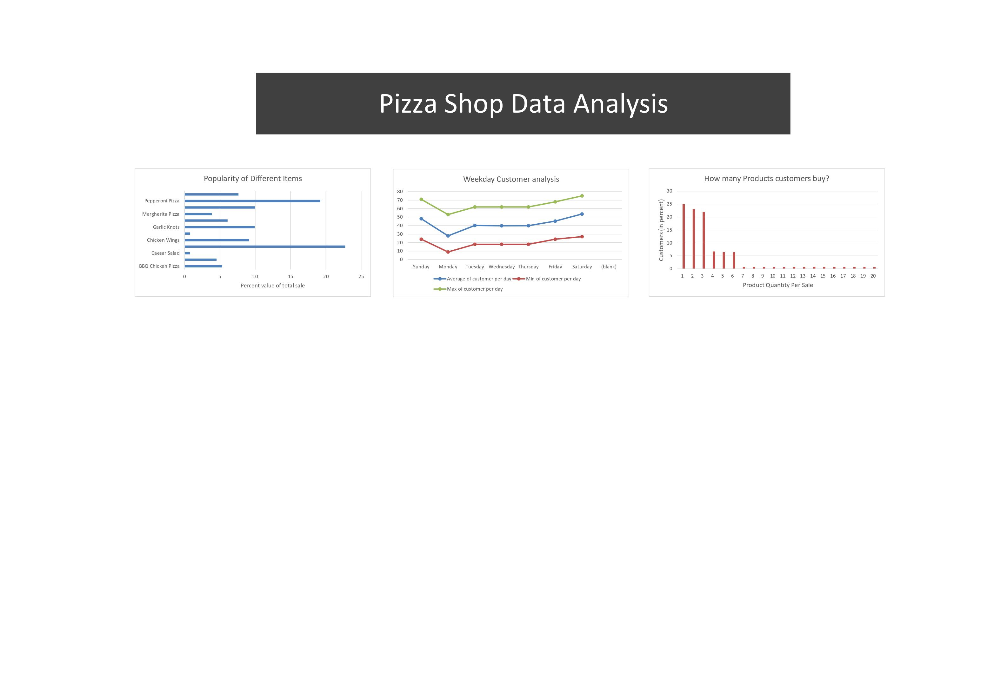

# Pizza shop sales simulation and Excel dashboard

How much cheese pizza should a shop expect to sell if it is the most frequently ordered item on the menu? This project models purchases at a fictional pizza shop in Python, then uses Excel PivotTables to explore item demand, basket sizes, daily order counts and revenue.



[Open the Excel analysis workbook](pizza_shop_Excel_data_analysis.xlsx)

## From a menu assumption to a dashboard result

Cheese pizza has a weight of 30 in the [generator settings](demo_sale_generator_constrains.xlsx). The twelve menu weights add up to 131. The [Python generator](sample_data_generator.py) samples items with `random.choices`, so cheese pizza has an expected share of **30 / 131 = 22.90%** of units. An order can include several units of the same item.

In the saved workbook, the **Sale of Diff. items** sheet reports **39,108 units of cheese pizza**, or **22.74%** of all units. This gives a manager a way to explore stocking assumptions. Raising another item's weight changes the expected mix across the whole menu. Actual purchasing decisions would need observed sales.

## How the simulation works

1. Draw the day's order volume from ranges weighted by weekday. Allocate orders to time blocks and then to hours.
2. Draw a basket size for each order and sample its items using the menu weights. The output records one row per distinct item in an order, with quantity and line revenue.
3. In Excel, group rows by order ID for basket sizes, sum quantities for item demand, and sum line revenue for daily sales. An order ID represents one transaction; the data cannot identify returning customers.

The [saved transactions](%20sample_data.xlsx) and dashboard workbook can be explored directly.

## Generate a new workbook

From the project directory, install the dependencies and run the generator:

```sh
python -m pip install pandas openpyxl
python sample_data_generator.py --output pizza_orders.xlsx --seed 42
```

The script loads the settings workbook beside the script and writes the new file in your current directory. Omit `--seed` for a fresh random sample. With the same settings and Python environment, using the same seed reproduces the transaction rows. Omit `--output` to use `generated_sales.xlsx`. Each run requires an unused filename.
